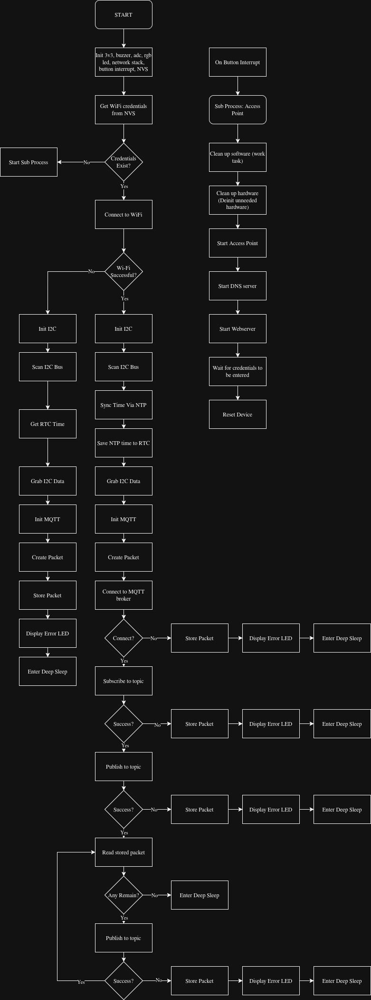

# JD608 - Grain Monitor Spear (ESP-IDF)

Created on the esp32-s2-solo-2

## `format_certfile.py`

The device connects directly to the Doover MQTT broker (`mqtt.doover.com:8883`) and logs in with a username and
password (`USERNAME` / `PASSWORD`: its agent ID and API token). TLS checks the broker against the CA bundle in
`ROOT_CA`; there is no device certificate.

The certfile downloaded from Doover has the device's details filled in but not the CA certificate itself, which the
device needs and cannot download. `format_certfile.py` fetches it from `ROOT_CA_URL`, adds it as `ROOT_CA` and writes
the result to `main/config/certfile.json`. It refuses a file with unfilled `{{ ... }}` placeholders, missing fields or
a `BROKER_ENDPOINT` that is not a bare hostname.

| Field | Used for |
|---|---|
| `DEVICE_NAME` | Sent as `d_id` in each packet |
| `BROKER_ENDPOINT`, `BROKER_PORT` | Broker host (bare hostname) and port |
| `CLIENT_ID`, `USERNAME`, `PASSWORD` | MQTT login |
| `MQTT_TOPIC_TO_PUBLISH_TO` | Where readings are published |
| `MQTT_TOPIC_TO_SUBSCRIBE_TO` | Where `device_config` (sleep interval) comes back |
| `ROOT_CA_URL` | Read by `format_certfile.py` only |
| `ROOT_CA` | CA bundle the broker's certificate is checked against |

### Steps for use

1) Download the device's certfile from Doover
2) Run `python3 format_certfile.py <downloaded file>` from this folder, or drop the file onto the script, or double
   click the script and pick the file
3) Build and flash. The file is embedded into the firmware

The generated file holds the device's password. Don't commit a filled-in copy; the committed one is a template.

## Flow Chart

